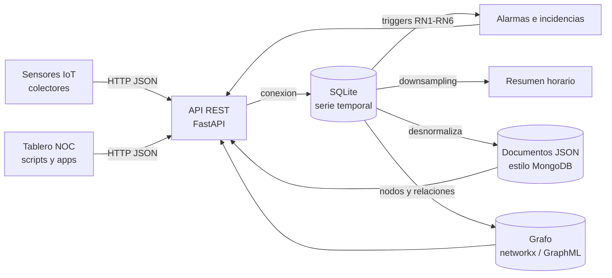
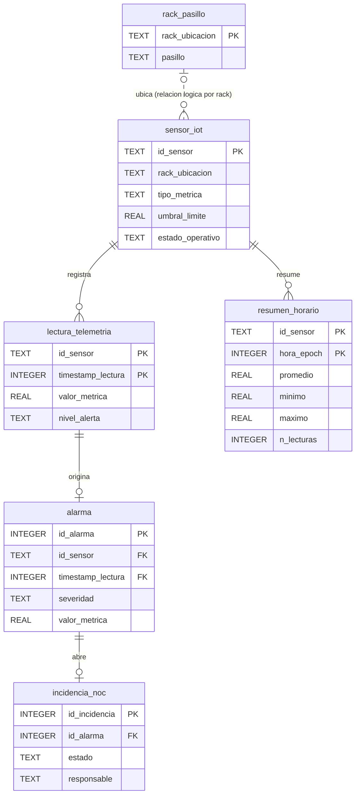
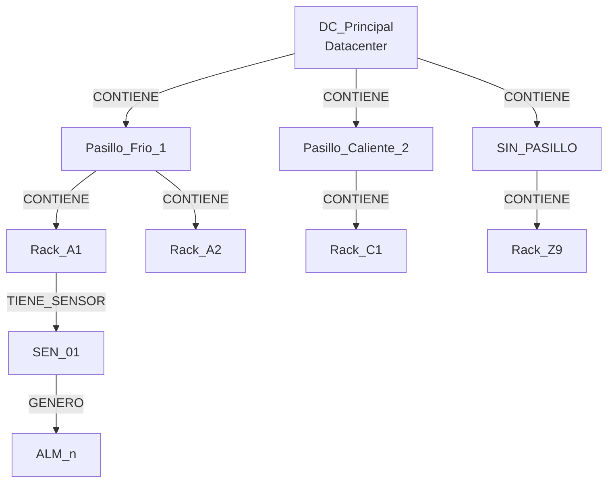
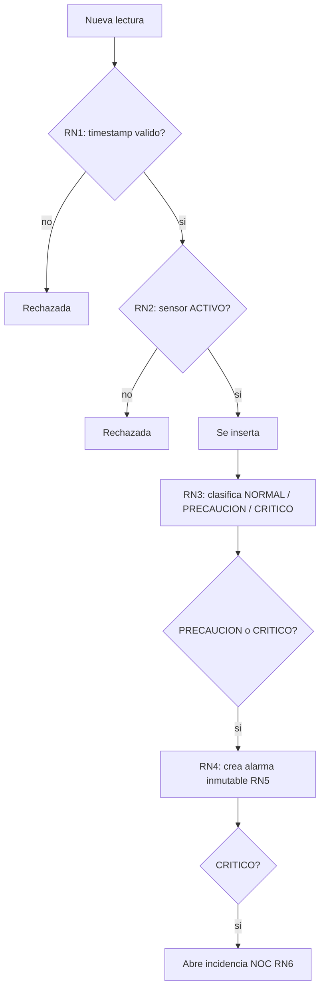

# Arquitectura del proyecto

## Visión general

SQLite es la **fuente de verdad** (series temporales, reglas de negocio y reportes). A partir de ella se
construyen dos vistas derivadas: un **almacén de documentos** (NoSQL) y un **grafo** de la topología. Las aplicaciones
externas (colectores IoT, tablero del NOC) acceden a todo mediante una **API REST**, que no duplica lógica: las reglas
de negocio viven en la base y la API solo traduce sus errores a códigos HTTP.

## Modelo relacional

`rack_pasillo` se relaciona con `sensor_iot` solo de forma **lógica** (sin llave foránea). Es deliberado: así los
ejemplos de RIGHT y FULL JOIN pueden mostrar racks sin sensores y sensores sin pasillo.

## Topología del grafo

## Flujo de una lectura (reglas de negocio)

## Decisiones de diseño

| Decisión | Motivo |
|---|---|
| Reglas en triggers y no en Python | Se cumplen siempre, sin importar qué aplicación inserte los datos |
| Clave primaria compuesta (sensor, tiempo) | Evita duplicados por reenvíos y crea el índice para consultas por rango |
| Timestamp como entero (epoch UTC) | Compacto, rápido de comparar y ordenar |
| Alarmas con FK hacia la lectura | Trazabilidad: toda alarma conserva el dato que la originó |
| La retención no borra lecturas con alarma | Se conserva la evidencia de las alarmas inmutables |
| API como única puerta de entrada para aplicaciones | Las aplicaciones no tocan la base directamente; las reglas siguen en los triggers |
| Documentos desnormalizados | Una pantalla del NOC se arma con un solo documento, sin JOINs |
| Grafo para impacto y trazabilidad | Recorridos como «qué se afecta si falla un pasillo» son una sola operación |
| Grafos en lugar de vectorial | La jerarquía del datacenter encaja de forma natural; lo vectorial queda como trabajo futuro |
